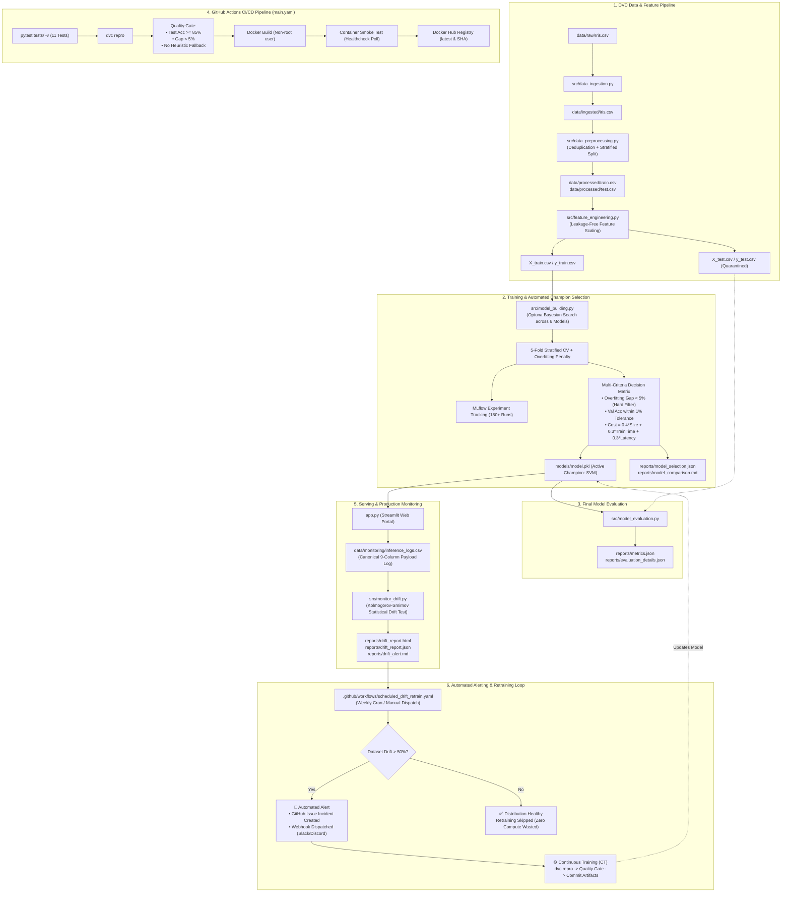

# 🌸 Iris End-to-End MLOps Pipeline & Production System

[](https://www.python.org/)
[](https://dvc.org/)
[](https://mlflow.org/)
[](https://optuna.org/)
[](https://www.docker.com/)
[](https://github.com/features/actions)
[](https://docs.pytest.org/)

An enterprise-ready, reproducible Machine Learning Operations (MLOps) system built on the classic Iris classification problem. The project demonstrates the full production ML lifecycle: **data versioning, automated multi-model Bayesian hyperparameter search, multi-criteria champion selection, test-set quarantine, containerized serving, CI/CD quality gates, and automated production data drift alerting with continuous retraining (CT)**.

---

## 🏛️ System Architecture



---

## 📁 Repository Directory Structure

```text
├── .dvc/                                   # DVC internal configuration and cache tracking
├── .github/workflows/
│   ├── main.yaml                           # CI/CD: Test, DVC Repro, Quality Gate, Docker Smoke
│   └── scheduled_drift_retrain.yaml        # CT: Scheduled Drift Monitor, Alerts & Auto-Retrain
├── data/
│   ├── raw/                                # Source raw dataset (Iris.csv)
│   ├── ingested/                           # Ingested and validated raw data
│   ├── processed/                          # Train/Test splits and separated feature files
│   └── monitoring/                         # Append-only production inference logs (git-ignored)
├── experiments/
│   └── legacy_prototype.py                 # Archived initial prototype
├── models/                                 # Trained candidate models & active champion model
│   ├── DecisionTree.pkl
│   ├── GaussianNB.pkl
│   ├── GradientBoosting.pkl
│   ├── KNN.pkl
│   ├── RandomForest.pkl
│   ├── SVM.pkl
│   └── model.pkl                           # Active champion model used in production
├── reports/                                # Generated audit, metrics, and monitoring reports
│   ├── drift_alert.md                      # Auto-generated Markdown incident report for alerts
│   ├── drift_report.html                   # Standalone visual HTML data drift dashboard
│   ├── drift_report.json                   # Structured Kolmogorov-Smirnov drift statistics
│   ├── evaluation_details.json             # Per-class classification reports and benchmarks
│   ├── metrics.json                        # Flat metrics tracked by DVC
│   ├── model_comparison.csv                # Benchmark metrics across all 6 models
│   ├── model_comparison.md                 # Markdown benchmark table (published to CI summary)
│   └── model_selection.json                # Champion selection rationale and scoring weights
├── src/                                    # Modular pipeline source code
│   ├── data_ingestion.py                   # Ingests, validates columns, strips ID column
│   ├── data_preprocessing.py               # Deduplication and stratified train/test split
│   ├── feature_engineering.py              # Isolates features and defers scaling to Pipeline
│   ├── model_building.py                   # Optuna HPT, 5-fold CV, multi-criteria champion selection
│   ├── model_evaluation.py                 # Independent evaluation on quarantined test set
│   └── monitor_drift.py                    # Inference logging, KS drift test, and alert dispatcher
├── tests/                                  # Automated test suite (pytest)
│   ├── __init__.py
│   ├── test_data.py                        # Data validation, schema, and split checks
│   ├── test_model.py                       # Model loading, inference, probabilities, determinism
│   └── test_monitoring.py                  # Payload logging, KS drift test, and alert tests
├── .dockerignore                           # Optimized Docker build context exclusions
├── .dvcignore                              # DVC file tracking exclusions
├── .gitignore                              # Git exclusions (ignores models, logs, cache)
├── app.py                                  # Multi-tab Streamlit production web application
├── Dockerfile                              # Production container definition (secure non-root user)
├── dvc.lock                                # Cryptographic manifest of DVC stage executions
├── dvc.yaml                                # Declarative DVC pipeline definition
├── params.yaml                             # Centralized configuration parameters
├── requirements-dvc.txt                    # Training, testing, and pipeline dependencies
└── requirements.txt                        # Minimal serving dependencies for Docker runtime
```

---

## ⚡ Core MLOps Pillars in this Project

### 1. Data & Pipeline Versioning (DVC)
The 5-stage DVC pipeline is declared in `dvc.yaml`. DVC caches intermediate stages and tracks dependencies:
```bash
dvc repro
```
If code or parameters haven't changed, stages are skipped instantly via hash matching.

### 2. Multi-Model Competition & Champion Selection
Instead of blindly picking the model with the highest validation score, `src/model_building.py` conducts Bayesian Optimization (Optuna `TPESampler`) across **6 model architectures**:
- **K-Nearest Neighbors (KNN)**
- **Decision Tree**
- **Support Vector Machine (SVM)**
- **Gaussian Naive Bayes (GaussianNB)**
- **Random Forest**
- **Gradient Boosting**

**Automated Selection Rules (`params.yaml`):**
1. **Hard Overfitting Filter:** The generalization gap $(Train\% - Val\%)$ must be strictly $< 5.0\%$.
2. **Accuracy Tolerance:** All models within $1.0\%$ validation accuracy of the best candidate become finalists.
3. **Multi-Criteria Normalized Cost:** Finalists are ranked by a weighted cost:
   $$\text{Cost} = 0.4 \times \text{Size}_{\text{norm}} + 0.3 \times \text{TrainTime}_{\text{norm}} + 0.3 \times \text{Latency}_{\text{norm}}$$
4. **Current Champion:** **SVM (Linear Kernel)** selected with:
   - **Validation Accuracy:** `98.33%`
   - **Test Accuracy:** `100.0%`
   - **Inference Latency:** `1.04 ms`
   - **Model Size:** `0.004 MB (4.4 KB)`

### 3. Continuous Integration & Quality Gates (GitHub Actions)
Every `push` and `pull_request` to `main` triggers `.github/workflows/main.yaml`:
1. **Automated Unit Testing:** Runs `pytest tests/ -v` (11 unit/integration tests).
2. **Pipeline Reproduction:** Executes `dvc repro`.
3. **Quality Gate:** Enforces test accuracy $\ge 85\%$, generalization gap $< 5\%$, and confirms no fallback heuristic was triggered.
4. **Job Summary:** Renders the model comparison table directly into the GitHub run summary.
5. **Container Smoke Test:** Builds the Docker image, boots it in the runner, and verifies `_stcore/health`.

### 4. Production Monitoring & Data Drift Detection
In `app.py`, every prediction request is logged to `data/monitoring/inference_logs.csv` with a canonical 9-column schema (timestamp, measurements, predicted class, and probability scores).
- `src/monitor_drift.py` runs a two-sample **Kolmogorov-Smirnov (KS) statistical test** comparing the current production distribution against the baseline training distribution (`data/processed/train.csv`).
- Produces both `reports/drift_report.json` and a visual dashboard at `reports/drift_report.html`.

### 5. Automated Alerting & Continuous Training (CT)
To guard against silent production decay, `.github/workflows/scheduled_drift_retrain.yaml` runs on a weekly schedule (Mondays at 00:00 UTC) or on-demand:
- **Incident Alerts:** When dataset drift exceeds the $50\%$ threshold, GitHub Actions automatically creates a **GitHub Issue** containing full statistical diagnostics (`reports/drift_alert.md`) and emits a webhook alert to Slack/Discord if configured (`ALERT_WEBHOOK_URL`).
- **Self-Healing Pipeline:** Upon drift detection, the workflow initiates automated Continuous Training (`dvc repro`), validates the new champion against strict quality gates, and commits the refreshed artifacts back to Git.
- **Compute Efficiency:** When traffic distributions remain healthy, retraining is skipped, avoiding unnecessary cloud compute.

---

## 🚀 Quickstart Guide

### 1. Clone & Set Up Python Virtual Environment
```bash
git clone https://github.com/Rahuljanji/Finalized_Class_MLops.git
cd Finalized_Class_MLops

# Create and activate virtual environment
python -m venv myenv
# Windows:
myenv\Scripts\activate
# Linux/macOS:
source myenv/bin/activate

# Install all dependencies (including training, DVC, Optuna, MLflow, and testing)
pip install -r requirements-dvc.txt
```

### 2. Run the Full DVC Pipeline
To reproduce all data preparation, model training, champion selection, and evaluation:
```bash
dvc repro
```
Inspect flat metrics:
```bash
dvc metrics show
```

### 3. Run the Automated Test Suite
```bash
pytest tests/ -v
```

### 4. Run Production Data Drift Analysis
Analyze production inference traffic against baseline:
```bash
# Normal traffic analysis:
python src/monitor_drift.py --generate-sample-data

# Simulate distribution shift (triggers alert generation):
python src/monitor_drift.py --simulate-drift
```
Open `reports/drift_report.html` in your browser to inspect the visual drift dashboard, or view the generated Markdown alert at `reports/drift_alert.md`.

### 5. Launch the Streamlit Production Application
```bash
streamlit run app.py
```
Open [http://localhost:8501](http://localhost:8501) in your browser. The app features:
- **🌸 Live Inference:** Real-time prediction with interactive sliders and class probabilities.
- **📊 Model Lineage:** Benchmark table across all 6 candidate models and selection rationale.
- **🛡️ Data Drift:** Live production traffic view and one-click drift detection.

---

## 🐳 Docker Deployment

The production image is optimized for deployment:
- Uses `python:3.11-slim` with lean runtime dependencies (`requirements.txt`).
- Runs securely under an unprivileged user (`appuser`).
- Built-in container healthcheck via `urllib.request`.

```bash
# Build the Docker image
docker build -t iris-mlops-app:latest .

# Run the container
docker run -d -p 8501:8501 --name iris-app iris-mlops-app:latest

# Check container health
docker ps
```
Visit [http://localhost:8501](http://localhost:8501) to interact with the running container.

---

## ☁️ Cloud Deployment Options (AWS)

1. **AWS S3 as DVC Cloud Remote Storage:**
   ```bash
   dvc remote add -d s3remote s3://your-mlops-bucket/dvcstore
   dvc push
   ```
2. **AWS App Runner / ECS:** Deploy the Docker container directly from Amazon ECR or Docker Hub with automatic HTTPS and load balancing.
3. **AWS EC2 (Free Tier):** Run the Docker container on an EC2 `t2.micro` or `t3.micro` instance at \$0/month under the AWS Free Tier.

---

## 📜 License
This project is open-source and available under the MIT License.
